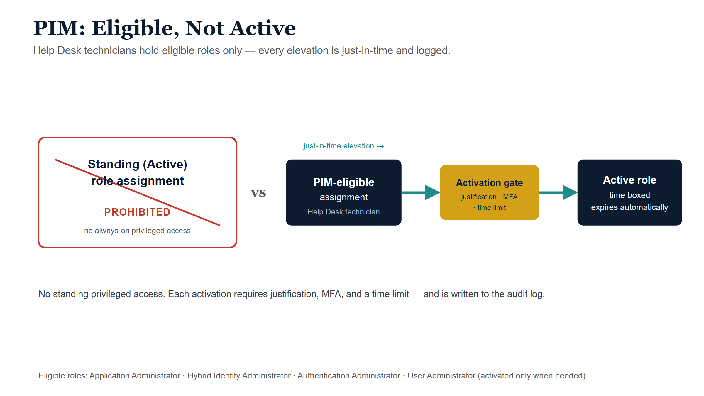
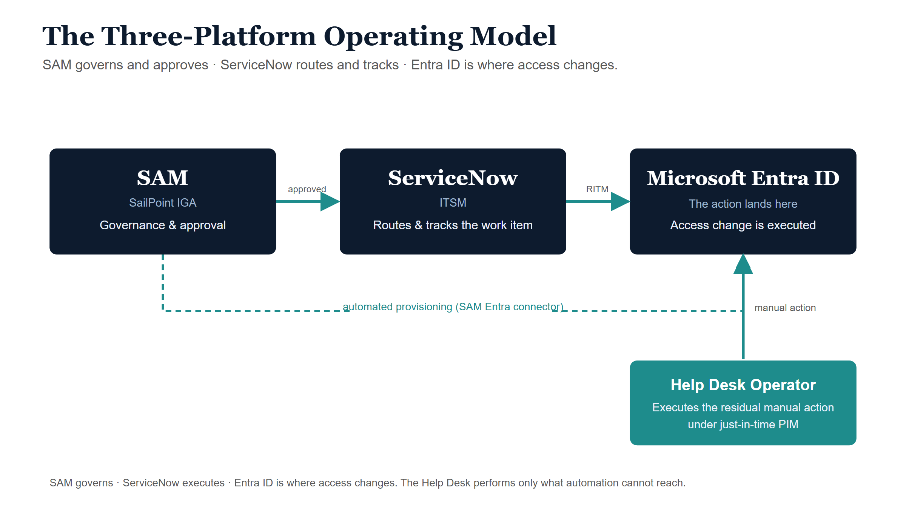
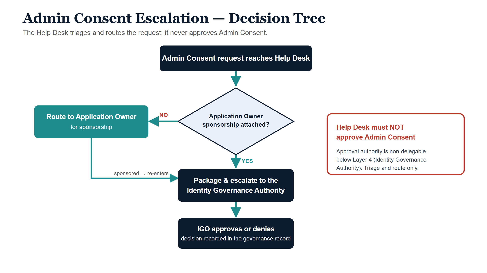

*Entra Governance Series — Document 1 of 3. Audience: IT leadership, Help Desk
supervisors, and Help Desk technicians. Platforms referenced: Microsoft Entra ID
· SAM (SailPoint IGA) · ServiceNow ITSM · Microsoft PIM.*

::: {.callout-note title="Document series notice"}
This document is **Document 1 of 3** in the agency's **Entra Governance** series.
Document 2 covers Privileged Identity Management (PIM) policy and elevation
procedures in full. Document 3 covers Identity Governance Officer (IGO)
responsibilities and Admin Consent governance. This guide should be read in
conjunction with both companion documents.
:::

::: {.callout-note title="Design guidance"}
Approval chains, authority boundaries, service levels, escalation triggers, review cadences, PIM setting values and naming conventions in this guide are the program's design guidance for the agency to adopt or adjust. Platform behavior is footnoted to Microsoft, ServiceNow and federal sources.
:::

## Purpose and scope

### Purpose

This guide establishes the authoritative reference for all **Microsoft Entra ID**
identity operations performed by Help Desk personnel within the agency. It
defines the authority boundaries of the Help Desk function, the privileged access
model under which Help Desk operators are permitted to act, the integration
requirements with the agency's **Systems Access Management (SAM)** platform and
**ServiceNow ITSM** environment, and the standard operating procedures for each
class of identity operation.

This document addresses a foundational architectural reality that all Help Desk
personnel and supervisors must understand: **Microsoft Entra ID has no single
"Help Desk" role that covers everything a help desk does.** Several built-in roles
each carry part of the work. *Helpdesk Administrator* (or the narrower *Password
Administrator*) resets passwords and invalidates refresh tokens for users who hold
no admin role; *Authentication Administrator* manages authentication methods,
requires MFA re-registration and issues Temporary Access Passes; enterprise
application assignment needs a narrow **custom role**, not Application
Administrator.[^ms-privileged][^ms-by-task] The agency's Help Desk operational
model is therefore built on controlled, PIM-gated **role-assignable groups**
holding those least-privilege roles — never on roles assigned to individual
technicians. Each role also limits *whose* account it can touch: most help desk
roles act only on users who hold no admin role, and none of them can reset a
member or owner of a role-assignable group.[^ms-privileged]

### Scope — what this guide governs

- All Microsoft Entra ID identity operations performed by Help Desk personnel,
  including password resets, MFA method resets and Temporary Access Passes (each
  after identity verification), Enterprise Application group assignments,
  OneDrive triage, and the detection and escalation of hybrid identity
  (ImmutableID) problems.
- The design and governance of the Help Desk Privileged Access Group (PAG) and
  Privileged Identity Management (PIM) elevation procedures.
- The integration workflow between the SAM platform (SailPoint-based IGA),
  ServiceNow ITSM, and Microsoft Entra ID for access requests and provisioning
  actions.
- Admin Consent triage and escalation procedures.
- Incoming notification and request handling from Microsoft Security notifications
  and ServiceNow-generated request items (RITMs).
- OneDrive sync issue triage, Entra-level resolution, and approval workflow.
- Escalation paths, audit requirements, and SLA obligations for all covered
  operations.

### Scope — what this guide does NOT cover

- **Global Administrator operations** — These are beyond Help Desk authority and
  are not documented here.
- **Admin Consent approval** — Help Desk may triage but never approve. Approval
  authority and procedure are documented in Entra Governance Document 3.
- **Conditional Access policy creation or modification** — Reserved for the
  Security Administrator role under Security Operations oversight.
- **Service Principal creation or management** — Reserved for Application Owners
  and Identity Engineering.
- **SAM platform administration** — SAM is a separate system governed under its
  own administrative procedures.
- **Entra ID Governance license features** (Access Packages, Entitlement
  Management, etc.) beyond what is explicitly documented herein.
- **Role assignment to other users or groups** — Help Desk may not assign or
  remove Entra directory roles.

### Applicability

This guide applies to all personnel occupying the **Help Desk Operator** function
within the agency's IT organization, including contracted support staff
performing Help Desk duties under agency oversight. Help Desk Supervisors are
responsible for ensuring all personnel under their supervision have read,
acknowledged, and are operating in accordance with this guide. Acknowledgment
records shall be maintained in the agency's personnel training system.

## Authority boundaries

The following table (design guidance) defines the precise boundary of Help Desk authority in
Microsoft Entra ID operations. This boundary is enforced by the **principle of
least privilege**, PIM-gated role elevation, and SAM-originated approval chains.
No action outside the "Authorized" column may be performed by Help Desk personnel
regardless of who requests it.

| **✓ Help Desk IS authorized to** | **✗ Help Desk is NOT authorized to** |
|---|---|
| Assign an Entra security group to an Enterprise Application with the custom app-assignment role, after SAM approval and ServiceNow RITM assignment. | Approve Admin Consent grants for Enterprise Applications — under any circumstances. |
| Remove an Entra group from an Enterprise Application, after SAM-originated RITM. | Create, modify, or delete Service Principals or App Registrations (including assigning application owners and decommissioning applications), or create Entra groups. Identity Engineering executes these. |
| Detect sync and ImmutableID problems and escalate them to Identity Engineering with the evidence (read-only). | Write `onPremisesImmutableId`, or hold Application Administrator or Hybrid Identity Administrator. |
| Reset MFA authentication methods, require MFA re-registration, and issue a one-time Temporary Access Pass using Authentication Administrator, after identity verification and supervisor approval. | Disable MFA, change authentication methods policy, or create, modify, or delete Conditional Access policies. |
| Reset passwords using Password Administrator or Helpdesk Administrator, after identity verification: cloud-only users through the Entra ID spoke; synced users in the Microsoft Entra admin center with password writeback (never the Microsoft 365 admin center), or in on-premises AD. | Modify Entra ID Connect (hybrid sync) configuration or sync rules. |
| Revoke a user's sessions during recovery or a suspected compromise (Helpdesk Administrator). | Reset, or change the methods of, a user who holds an admin role, is a member or owner of a role-assignable group, or sits in a restricted management administrative unit. |
| Triage Admin Consent notifications — verify, log, and escalate to Application Owner and IGO. | Grant OAuth permissions or delegated permissions to any application. |
| Confirm a licensed user's OneDrive state and route pre-provisioning to a SharePoint Administrator. | Modify license assignments except when authorized via a SAM-originated RITM with Departmental Owner approval. |
| Check Entra Sign-in Logs and Audit Logs for diagnostic purposes during triage (Reports Reader; Security Reader to see which Conditional Access policies applied). | Export, copy, or retain Entra audit log data outside approved SIEM or logging systems. |
| Check device compliance status and Entra Join status for OneDrive and access triage. | Delete or disable user accounts except via explicit, multi-approved SAM lifecycle workflow. |
| Execute PIM elevation (role activation) for approved roles via the PAG, with written justification entered in PIM request. | Maintain standing (persistent) active role assignments. All privileged access is time-bound and eligible only. |
| Document all actions in the associated ServiceNow ticket before closing the RITM. | Perform any Entra operation without a corresponding ServiceNow ticket in "Assigned" status. |

::: {.callout-warning title="Prohibited action"}
**Help Desk personnel may NEVER approve Admin Consent grants for Enterprise
Applications, regardless of the source of the request (email, ticket, verbal).**
Admin Consent approval authority is reserved exclusively for the **Identity
Governance Officer (IGO)** or **Global Administrator** acting under IGO direction.
Help Desk role is **triage and escalation only**. Any technician who approves an
Admin Consent grant outside this chain will be considered to have acted outside
their authority and will be subject to disciplinary and security review
procedures.
:::

::: {.callout-note title="Capability is not authority"}
Several roles can do more than the Help Desk may. Authentication Administrator can
delete, disable and enable users and change their UPN for the users in its scope;
User Administrator can delete users and create guests.[^ms-privileged][^ms-by-task]
"The Help Desk doesn't delete accounts" is therefore a procedural rule, enforced
twice: in the ticket, which must carry the approval, and in SIEM monitoring, which
flags any directory change by a Help Desk account with no matching ticket.
:::

## Verify the person before a credential action

Approval answers *should this be done?* It does not answer *is this caller the
person the account belongs to?* Password resets, MFA resets, Temporary Access
Passes and account recovery need both answers — and the Help Desk is where
attackers go for the second. CISA's Scattered Spider advisory describes actors who
posed as employees to convince help desk staff to reset passwords and move MFA to
devices the actors controlled.[^cisa-spider] A manager's approval of an MFA reset
is worthless if the caller is an attacker who has also emailed the manager. An A0
password reset needs no approval, but it still needs verification.

**Step 1 — check the target.** Before any credential or method action, confirm the
user holds no directory role (active or eligible), is not a member or owner of a
role-assignable group, and is not in a restricted management administrative unit.
Any hit stops the Help Desk: route the request to Identity Engineering (limited
admins) or a Tier 0 role holder (privileged or protected accounts).[^ms-privileged]

**Step 2 — verify the person**, by the program's ladder (a CISO decision; these are
defaults), measured against NIST SP 800-63B-4's account-recovery rules:[^nist-63b]

| Situation | Verification accepted | Then |
|---|---|---|
| The user can still sign in with a phishing-resistant method (passkey or PIV) | The user raises or confirms the ticket from an authenticated session | Reset or bind the new method |
| The user can sign in with a weaker method only | An authenticated session plus a second check the CISO approves, such as a video call matched against the badge photo | Bind a phishing-resistant method as part of the fix |
| The user has lost every method | Identity proofing: Entra account recovery where available, or in-person verification against a PIV card or government ID | One-time Temporary Access Pass with a short lifetime, handed over in the session |
| The target holds a directory role, or fails the target check | None at the Help Desk | Escalate |
| Anything else | Not accepted | Email alone, caller ID, a callback to a number the caller supplies, knowledge questions and a manager's say-so verify no one |

**Step 3 — notify.** Every reset or recovery triggers a notice to the user through a
channel other than the one just recovered. The ticket records *which rung* of the
ladder was used — never the evidence itself (no document numbers, photos or dates
of birth).

## Help Desk Privileged Access Group (PAG) design

### How this replaces OU-based helpdesk delegation

In Active Directory, helpdesk delegation was scoped by placing the target users in an OU and granting rights on that OU — implicit containment. Entra ID has no OU tree. The equivalent is an **Administrative Unit (AU)** combined with a scoped Entra role:

| AD model | Entra equivalent in this guide |
|---|---|
| Helpdesk delegated on `OU=Agency-Users` | Helpdesk Administrator (resets) and Authentication Administrator (methods) scoped to agency AU |
| Password reset rights on `OU=Field-Offices` | Password Administrator scoped to field-office AU (OrgPath rule) |
| OU ACL giving group membership write | Groups Administrator scoped to department AU |
| Standing delegated admin (persistent) | PIM-eligible assignment — never standing active |

AU membership is driven by OrgPath facet predicates in a dynamic membership rule (e.g., `user.extensionAttribute2 -eq "IT"`), so scope tracks org structure automatically without manual OU management. Dynamic AU membership needs an Entra ID P1 license for each member and is not available in specialized clouds such as Azure Government.[^ms-au-dynamic] The PAG and PIM configuration below operationalize the role-binding side of this model.

Two limits of AU scope matter. An AU-scoped role acts only on members of the unit
who hold **no** administrator role, so a reset for a limited administrator inside
the unit goes to Identity Engineering. And an AU limits what a technician can
change, not what they can see.[^ms-au-roles] Executive accounts that the Help Desk
must not reset at all belong in a **restricted management administrative unit**,
administered only by roles assigned at that unit's scope.[^ms-rmau]

### Why group-based role assignment instead of individual role assignments

Microsoft Entra ID permits Entra directory roles to be assigned directly to
individual users. However, for Help Desk operations, direct individual role
assignments create unacceptable governance risk: they cannot be consistently
time-bound, they cannot enforce approval workflows before elevation, they are more
difficult to audit consistently, and they increase the attack surface in the event
of account compromise. The agency's identity governance model therefore
implements a **Privileged Access Group (PAG)** as the sole mechanism for granting
Help Desk personnel access to elevated Entra roles.

Under the PAG model:

- Entra directory roles (Helpdesk Administrator, Authentication Administrator,
  and the custom enterprise-app assignment role) are assigned to the PAG, **not to
  individual users**.
- Help Desk technicians are members of the PAG with **eligible** assignment — they
  do not hold the roles actively until they explicitly activate via PIM.
- Every role activation is individually logged, requires a written justification,
  and is time-bound (maximum session defined in the PIM configuration below).
- Adding or removing a technician from the PAG (onboarding/offboarding) is itself a
  governed, approver-controlled operation in PIM and SAM.
- The group also **protects its members**: only Privileged Authentication
  Administrators and Global Administrators can reset the credentials of a
  role-assignable group's members or owners, so one technician cannot reset
  another's password and inherit their access.[^ms-privileged]

"Privileged Access Group" was Microsoft's name, until January 2023, for what is now
**PIM for Groups**.[^ms-pim-groups] The recommended refinement is **one
role-assignable group per role and scope** (for example
`PRV-T2-PasswordAdmin-AU-FieldOps`), each holding one eligible role at one AU's
scope; the single-group options below remain valid for a small team.

### PAG naming convention

The agency's Privileged Access Group for Help Desk Entra operations shall be named
according to one of the following approved conventions, as adopted by the Identity
Engineering team during initial deployment:

| **Naming option** | **Group display name** | **Group type** | **Use case** |
|---|---|---|---|
| Option A (Recommended) | **Entra-HelpDesk-Operators** | Security Group, Role-Assignable | Standard agencies where IT is a single function |
| Option B | **IDM-HelpDesk-Operations** | Security Group, Role-Assignable | Agencies with a separate Identity Management (IDM) function within IT |

The group **must** be created as a **Role-Assignable Security Group** in Entra ID.
A group created without the role-assignable setting can never hold a Microsoft
Entra role; the setting is available for security and Microsoft 365 groups and only
at creation.[^ms-rag] Group creation is performed by Identity Engineering (it needs
Privileged Role Administrator), not by Help Desk.

::: {.callout-note title="Note"}
Role-assignable groups require **Entra ID P1**; just-in-time activation through PIM
requires **Entra ID P2** (or Microsoft Entra ID Governance).[^ms-rag] A
role-assignable group's `isAssignableToRole` property is set only at creation, it
cannot have dynamic membership or nested groups, and a tenant can have at most 500
of them. Confirm licensing is in place with Identity Engineering before PAG
deployment.
:::

### PIM configuration — eligible, not active

{#fig-pim-eligible fig-alt="A blueprint contrasting two states. Left, a red-outlined box labelled Standing (Active) assignment — prohibited, struck through. Right, a navy box labelled PIM-eligible assignment with a teal just-in-time activation arrow passing through an amber gate labelled justification plus MFA plus time limit, arriving at a navy time-boxed active role box that expires. A grey footer: no standing privileged access; every elevation is logged." width="100%"}

All role assignments within the PAG are configured as **Eligible** in Microsoft
Entra Privileged Identity Management (PIM). Under no circumstances shall Help Desk
personnel hold **Active (standing)** role assignments for Helpdesk Administrator,
Password Administrator, Authentication Administrator, User Administrator, or the
custom app-assignment role. The following PIM configuration settings apply (the
Tier 2 values, as design guidance; PIM settings are per role, so every holder of a role in the tenant
shares them):[^ms-pim-settings]

| **PIM setting** | **Required value** | **Rationale** |
|---|---|---|
| Assignment type | **Eligible** (not Active) | No standing privilege; elevation is explicit and logged |
| Maximum activation duration | **8-hour ceiling** (Tier 2); shorter (1–24 hours) is possible but applies tenant-wide to that role | Minimizes exposure window for privileged session |
| Approval required for activation | **The task approval lives in the ticket.** PIM approval is optional for Tier 2 under a documented risk acceptance, and required for the high-risk tasks that need a second approver | Two-person integrity without double-approving routine work |
| Justification required | **Yes** — ServiceNow RITM number and brief action description required in justification and ticket fields | Links every elevation to a governed work item |
| MFA required on activation | **Yes** — Phishing-resistant MFA (FIDO2 or certificate-based), enforced through a Conditional Access authentication context with a phishing-resistant authentication strength; PIM's own MFA option does not fix the method and may not prompt again in a session[^ms-pim-authctx] | Prevents credential-based elevation abuse |
| Eligible assignment expiration | **180 days** — PAG membership reviewed quarterly; must be re-approved | Ensures access certifications are enforced |
| Notification on activation | **Yes** — Alert to Help Desk Supervisor and Identity Engineering inbox | Real-time awareness of privilege use |

### Full audit trail

Every PIM elevation generates an immutable audit event in the Entra ID Audit Logs
and is captured by the agency's SIEM system. The audit record includes: the UPN of
the activating technician, the role activated, the justification text entered, the
timestamp of activation and deactivation, and the approver's UPN. This record is
retained per the audit and compliance requirements of this guide. Help Desk
personnel must enter the ServiceNow RITM number (e.g., "RITM0045821") in the PIM
justification and ticket fields. PIM does **not** check that number against any
ticketing system;[^ms-pim-settings] the flag on activations without a valid RITM
exists only because the agency builds it — a SIEM rule that joins each
activation's ticket number to ServiceNow and alerts on any unmatched number.

### Onboarding a technician to the PAG

1. Help Desk Supervisor submits a SAM access request for the technician,
   specifying the **Entra-HelpDesk-Operators** PAG.
2. SAM routes the request through the standard approval chain: Departmental Owner →
   IGO (due to privileged nature).
3. Upon IGO approval, SAM generates a ServiceNow RITM tasked to Identity
   Engineering.
4. Identity Engineering adds the technician's account to the PAG in Entra ID as an
   **Eligible** member via PIM.
5. Identity Engineering resolves the RITM and notifies the Help Desk Supervisor.
6. Technician completes required PIM training and acknowledges this guide before
   first elevation.

### Offboarding a technician from the PAG

1. Supervisor submits offboarding or role-removal request in SAM upon technician
   departure, role change, or disciplinary action.
2. SAM immediately flags the account for access removal. IGO approval is not
   required for removals — removal is executed on SAM approval alone.
3. ServiceNow RITM is generated to Identity Engineering for immediate PAG
   membership removal.
4. Identity Engineering removes the technician's eligible assignment from PIM and
   resolves the RITM.
5. If a PIM session is active at the time of removal, Identity Engineering must
   also terminate any active role sessions.

## Assigned Entra roles and their scope

The following roles are the complete set assignable to the Help Desk PAG. Three
are required; the others are optional and must be explicitly authorized by the IGO.
Each is the least-privileged role Microsoft documents for its task.[^ms-by-task]

| **Role** | **Required / Optional** | **Authorized tasks** | **NOT authorized under this role** | **Notes** |
|---|---|---|---|---|
| **Helpdesk Administrator** (or the narrower **Password Administrator**) | **Required** | Reset passwords for users with no admin role. Invalidate refresh tokens (revoke sessions). | Resetting anyone who holds an admin role, or a member or owner of a role-assignable group. | Helpdesk Administrator can also act on a few limited roles (Directory Readers, Guest Inviters, Password Administrators, other Helpdesk Administrators, Message Center Readers, Reports Readers, Usage Summary Reports Readers and User Experience Success Managers); Password Administrator acts only on non-admins, Directory Readers, Guest Inviters and other Password Administrators.[^ms-privileged] Choose Password Administrator where resets are the only need. |
| **Authentication Administrator** | **Required** | Delete or reset a user's authentication methods. Require MFA re-registration. Issue a Temporary Access Pass to members (not to administrators, not to self). Register a method on a user's behalf after verification. | Managing methods for users holding admin roles. Changing authentication methods policy, MFA settings or the Temporary Access Pass policy (Authentication Policy Administrator). Disabling MFA. | It **cannot** "disable MFA": tenant MFA settings belong to Authentication Policy Administrator, and the program does not use per-user MFA.[^ms-privileged] A user who has lost every method gets a Temporary Access Pass. The role can also delete, disable and enable users — a capability the Help Desk may not use. |
| **Help Desk Enterprise App Assignment** (custom role) | **Required** | Assign and remove users and groups on enterprise applications. | Creating apps, granting consent, adding credentials, changing app configuration. | A custom role holding only `microsoft.directory/servicePrincipals/appRoleAssignedTo/update`, scoped to one app or the tenant; each assignee needs Entra ID P1.[^ms-custom-apps] `New-HelpDeskPAG.ps1 -CreateAppAssignmentRole` creates it. |
| **User Administrator** | **Optional — Restricted** (IGO authorization required; use with caution) | Update basic profile attributes per a SAM-initiated change request, where the attribute is not HR-mastered and the user is cloud-managed. | Deleting user accounts. Creating guests. Assigning directory roles. Managing users who hold admin roles. | The broadest optional role: it can delete users, create guests, change licenses and reset limited administrators.[^ms-by-task][^ms-privileged] Activate only for the specific task authorized in the RITM. Annual IGO re-authorization required. |
| **License Administrator** | **Optional** | Assign or remove licenses when authorized via a SAM-originated RITM with Departmental Owner approval. | Changing group-assigned licenses on a user (change the group instead). | The least-privileged role for license assignment.[^ms-by-task] |
| **Reports Reader** / **Security Reader** | **Optional** (read-only) | Read sign-in and audit logs inside an assigned ticket; Security Reader also shows which Conditional Access policies applied. | Exporting or copying log data. | Reading logs does not need Application Administrator.[^ms-by-task] |

::: {.callout-important title="Roles the Help Desk does not hold"}
- **Application Administrator** can grant consent to delegated permissions and to
  application permissions outside Microsoft Graph, and can create enterprise
  applications.[^ms-by-task] A Help Desk that activated it could technically perform
  the one action the Help Desk must never take. It stays with Identity
  Engineering; the custom assignment role replaces it.
- **Hybrid Identity Administrator** manages Entra Connect, cloud sync, pass-through
  authentication, password hash sync, seamless SSO and federation. It is **not**
  among the roles that can update `onPremisesImmutableId` (Authentication, User and
  Privileged Authentication Administrator, and Global Administrator, each for the
  users in Microsoft's table).[^ms-graph-users] ImmutableID repair moved to Identity
  Engineering — see [Hybrid identity operations](#hybrid-identity-operations).
- **Privileged Authentication Administrator** is the only one of these roles that can
  reset a privileged administrator. That is why it is Tier 0 and outside the Help
  Desk.
:::

## SAM — Systems Access Management integration

### Overview — the three-platform model

{#fig-three-platform fig-alt="A left-to-right blueprint. A navy SAM box (governance and approval) feeds a navy ServiceNow box (ITSM routing and tracking) via a teal arrow, which feeds a navy Entra ID box (where the action lands) via a teal arrow. Below the Entra box, a teal Help Desk Operator box connects upward, labelled executes the residual manual action under just-in-time PIM. A grey footer notes: SAM governs, ServiceNow executes, Entra ID is where access changes." width="100%"}

The agency's access management architecture operates across three distinct but
integrated platforms. Help Desk personnel must understand the distinct role and
authority of each platform and must never conflate their functions.

| **Platform** | **Role in the architecture** | **Who administers it** | **Help Desk relationship** |
|---|---|---|---|
| **SAM (SailPoint IGA)** | Governs WHO gets access. Routes approvals through business and technical owners. Enforces access policy. Provisions to connected systems via automated connectors. Runs periodic access certifications. Source of truth for access decisions. | IAM / Identity Governance team | **Downstream** — Help Desk executes only what SAM has already approved. Help Desk does not make access decisions. |
| **ServiceNow (ITSM)** | Tracks work effort. Manages IT change records and request items (RITMs). Enforces SLAs. Provides the audit trail for ITSM actions. Receives auto-generated tasks from SAM and Entra alerts. | ITSM / Service Desk Operations | **Operational interface** — Help Desk works tickets here. Every Entra action must trace to a ServiceNow ticket. |
| **Microsoft Entra ID** | Enforces access at the identity layer — group memberships, app role assignments, Conditional Access policies, PIM governance, device compliance, hybrid identity sync. | Identity Engineering, Security Operations, Help Desk (within scope) | **Execution target** — Help Desk makes Entra changes only after SAM approval and ServiceNow task assignment. |

::: {.callout-note title="Key principle"}
**Help Desk is downstream of SAM.** Help Desk executes manual Entra ID actions
that SAM cannot automate — after SAM has approved the request and after ServiceNow
has created and assigned the task. Help Desk never makes access governance
decisions independently.
:::

### SAM actors relevant to Help Desk workflow

| **SAM actor** | **Role in workflow** | **Help Desk interaction** |
|---|---|---|
| **Access Requester** | Submits access request in SAM portal. Provides business justification and requested application/role. | None — entirely upstream of Help Desk. Help Desk does not receive or process SAM portal submissions directly. |
| **Business Approver (Departmental Owner)** | First-level approval in SAM. Validates that the requester has a legitimate business need for the requested access. | None — upstream approval. Help Desk is notified only after this approval is complete. |
| **Application Owner** | Second-level approval in SAM for application-specific access. Confirms the requester should be provisioned to the specific application role. | Help Desk is notified via ServiceNow RITM after Application Owner approval completes. For Admin Consent escalations, Help Desk routes to Application Owner for IGO referral. |
| **Identity Governance Officer (IGO)** | Final approval authority in SAM for high-risk access, ImmutableID changes, and all Admin Consent matters. Acts directly for Admin Consent approvals in the Entra portal — Help Desk does not handle that action. | For high-risk actions: Help Desk executes the Entra action only after IGO approval appears in the ServiceNow ticket. ImmutableID changes are executed by Identity Engineering, not the Help Desk. For Admin Consent: IGO acts directly — Help Desk role is triage and escalation to Application Owner, who refers to IGO. |
| **SAM System (Automated)** | Provisions access via Entra ID connector for apps and groups that have a configured SAM-Entra connector with write access to the target resource. | Help Desk handles residual manual steps SAM cannot automate — primarily Enterprise Application group assignments where the SAM connector lacks write access to app role assignments. ImmutableID operations go to Identity Engineering. |
| **Help Desk Operator** | Receives ServiceNow RITM task after all required SAM approvals are complete. Executes the Entra action. Resolves the task with full documentation. | Performs PIM elevation, executes action in Entra portal or PowerShell, validates result, documents in ServiceNow, and resolves ticket. |

### How SAM auto-routes to ServiceNow

Help Desk personnel do not execute any Entra action until all three of the
following conditions are met:

1. **SAM shows the request as fully approved** — all approval stages in the SAM
   workflow are in "Approved" status. If any stage is pending, incomplete, or
   returned, Help Desk waits. Help Desk does not contact SAM actors to expedite
   approvals.
2. **A ServiceNow RITM task is in the Help Desk queue in "Assigned" status** — the
   task has been generated by SAM's ServiceNow integration, assigned to the Help
   Desk group, and is actively awaiting action. Tickets in "New," "Pending
   Approval," or "On Hold" status are not ready for action.
3. **The RITM contains all required metadata** — the ticket must include: the full
   approval chain (all approver names and approval timestamps), the requester's
   name and UPN, the target application name, the risk tier assigned by SAM, and
   the specific action required of Help Desk.

If any of these conditions is not met, Help Desk must place the ticket On Hold and
contact the SAM team or Help Desk Supervisor. Help Desk may not proceed on partial
information.

### SAM automation vs. Help Desk manual action

| **Action** | **Why SAM cannot automate** | **Help Desk action required** | **PIM role required** |
|---|---|---|---|
| Admin Consent approval | Requires a human administrator decision. Tenant-wide consent needs Privileged Role Administrator (any permission), or Cloud Application or Application Administrator (any permission except Microsoft Graph application permissions).[^ms-grant-consent] Cannot be scripted via SAM connector safely. | **ESCALATE ONLY** — Help Desk triages, documents, and escalates to IGO via Application Owner. IGO acts directly. Help Desk documents outcome. | N/A — Help Desk does not perform this action. |
| Group assignment to Enterprise Application role | SAM Entra connector may lack write access to app role assignment endpoint for specific applications. Not all apps are connector-provisioned. | Assign the SAM-approved group to the specified app role in Entra Enterprise Apps blade. | Yes — custom app-assignment role |
| ImmutableID mismatch | Not connector-executable, and not a Help Desk task. Usually fixed in AD (set `mS-DS-ConsistencyGuid`) by Identity Engineering; Entra ID blocks risky hard matches since July 1, 2026. | **Detect and escalate** to Identity Engineering with the evidence. See the Hybrid identity operations section. | No — Help Desk holds no role for this |
| MFA method reset | No connector action: neither SAM nor the Entra ID spoke manages authentication methods. | Verify the person, then reset the specified methods via Entra admin center → Users → Authentication methods, or issue a Temporary Access Pass. | Yes — Authentication Administrator |
| OneDrive provisioning | OneDrive is created the first time a licensed user browses to it; pre-provisioning (`Request-SPOPersonalSite`) needs a SharePoint Administrator. | Confirm license and sign-in state; route pre-provisioning to a SharePoint Administrator. | No — not a Help Desk action |
| Entra group creation | SAM flags the need for a new Entra group; Identity Engineering creates it. | **Escalate** to Identity Engineering with the approved RITM and the proposed name per the naming convention. Confirm with the SAM team after Identity Engineering creates it. | No — Help Desk does not create groups |

## Incoming request types

### Microsoft Security notifications

#### What these notifications are

Microsoft generates automated security and consent-related email notifications to
tenant administrators and users. They come from **more than one sender**:
`MSSecurity-noreply@microsoft.com` is the documented sender for PIM notifications;
`azure-noreply@microsoft.com` sends access review, Connect Health, ID Protection
and application certificate and provisioning notices; self-service password reset
notices use other addresses again, with separate ones for Azure for US
Government.[^ms-pim-email][^ms-ops-notify] Common notification types include: Admin
Consent request notifications, sign-in risk alerts, identity protection risk
detections, and service health notifications. A sender check spots an obvious fake;
it is **not proof** that a message is genuine. The check that counts is the tenant
itself: the event the email describes, found in the Entra audit log and matched to
an approved ticket.

::: {.callout-warning title="Admin Consent emails"}
Help Desk personnel who receive or are forwarded a Microsoft Admin Consent request
email **must NOT** click the "Review permissions" or "Approve" link and approve
the consent grant. These links, if followed and approved by an account
holding a consent-capable role (such as Application Administrator, which the Help
Desk does not hold), execute a consent grant with elevated scope. Forward the email to the Application Owner and document in
ServiceNow. Do not action the email. See the Admin Consent triage workflow for the
full procedure.
:::

#### Help Desk triage steps for Microsoft Security notifications

1. **Validate legitimacy** — Check the sender is a Microsoft address (for example
   `MSSecurity-noreply@microsoft.com` or `azure-noreply@microsoft.com`). Spoofed
   addresses may use similar but distinct domains; if the domain is not
   microsoft.com, treat as phishing and report to the SOC. A correct sender is not
   proof — Step 3 is.
2. **Identify notification type** — Is this an Admin Consent request, a risk
   alert, an identity protection detection, or a service health notice?
3. **Check Entra Audit Logs** — Navigate to Entra admin center → Entra ID →
   Monitoring & health → Audit logs.[^ms-activity-logs] Filter by the relevant user or application. Confirm whether any action
   has already been taken in the tenant (e.g., a consent grant already executed).
4. **Do NOT approve** Admin Consent grants based on the email. See the Admin
   Consent triage workflow.
5. **Create or update ServiceNow ticket** — Document the notification, your triage
   findings, and your escalation action.

| **Notification type** | **Help Desk action** | **Escalation path** |
|---|---|---|
| Admin Consent request | Triage and escalate. Do NOT approve. | Application Owner → IGO. See the Admin Consent triage workflow. |
| Sign-in risk alert (user risk elevated) | Check sign-in logs. If confirmed compromise risk, place account on hold and escalate. | Security Operations Center (SOC) + Help Desk Supervisor |
| Identity Protection risk detection | Document detection. Do not remediate risk policy settings. | Security Operations / Identity Engineering |
| Service health / outage notification | Check M365 Service Health Dashboard. Correlate with active user-reported issues. | Notify Help Desk Supervisor. Update open tickets with known-issue note. |

### ServiceNow request types

The following RITM types may appear in the Help Desk ServiceNow queue. Each is
described with the required validation, approval authority, and resolution steps.

#### SAM-generated RITM — Enterprise Application group access request

- **Description:** A user or group has been approved in SAM for access to an
  Enterprise Application. The SAM-Entra connector could not automate the group
  assignment. ServiceNow RITM is auto-created and assigned to Help Desk.
- **Required validation:** Confirm SAM request status is "Fully Approved." Confirm
  the group name in the RITM matches an existing Entra security group. Confirm the
  application name matches a registered Enterprise Application in Entra.
- **Approval authority:** SAM approval chain (already complete). No additional
  approval needed at execution stage.
- **PIM required:** Yes — custom app-assignment role.
- **Resolution steps:** See the Enterprise Application access assignment
  procedures.

#### SAM-generated RITM — Access certification revocation

- **Description:** A periodic SAM access certification has resulted in a revocation
  decision for a user's application access. SAM creates a ServiceNow RITM to remove
  the group assignment from the Enterprise Application.
- **Required validation:** Confirm the SAM certification decision is "Revoked" and
  has been finalized (not pending). Confirm the group and application names match
  Entra objects. Do not remove access if the certification is still in-progress.
- **Approval authority:** SAM certification result is authoritative — no additional
  approval.
- **PIM required:** Yes — custom app-assignment role.
- **Resolution steps:** Remove group from app role assignment in Entra Enterprise
  Apps blade. Document the certification ID in the ServiceNow ticket. Resolve
  ticket.

#### Admin Consent escalation ticket

- **Description:** A ServiceNow ticket requesting Admin Consent approval,
  originated by a user, manager, or forwarded Microsoft notification.
- **Required action:** TRIAGE AND ESCALATE ONLY. See the Admin Consent triage
  workflow.
- **Approval authority:** IGO or Global Administrator only. Help Desk does not
  approve.
- **PIM required:** No — Help Desk does not execute this action.

#### ImmutableID / sync mismatch ticket

- **Description:** A user's on-premises AD account and Entra ID cloud account
  appear de-synced (sign-in failures, a duplicate object, a stale last-sync time).
- **Help Desk action:** Detect and document, then escalate to Identity
  Engineering. The Help Desk does not change either value.
- **Approval authority:** Identity Engineering Lead + IGO (both required) approve
  the fix that Identity Engineering executes.
- **PIM required:** No — the Help Desk holds no role for this task.
- **Resolution steps:** See the Hybrid identity operations section.

#### MFA reset request

- **Description:** A user cannot authenticate due to lost MFA device or method
  failure. ServiceNow RITM has been created and Help Desk Supervisor has approved.
- **Required validation:** Run the target check and verify the person by the
  ladder in [Verify the person before a credential action](#verify-the-person-before-a-credential-action)
  (never email, caller ID or knowledge questions alone). Confirm Supervisor
  approval in the ServiceNow approval task.
- **Approval authority:** Help Desk Supervisor (or the requester's manager).
- **PIM required:** Yes — Authentication Administrator.
- **Resolution steps:** See [Temporary Access Pass and MFA recovery](#temporary-access-pass-and-mfa-recovery).

#### OneDrive sync issues — user self-service

- **Description:** User submits ServiceNow catalog item "OneDrive Sync Issue."
  Ticket is auto-assigned to Help Desk.
- **Required validation:** Ticket in Assigned status. No additional pre-approval
  required for client-side triage. Entra-level actions require approval as
  documented in the OneDrive sync issues section.
- **Approval authority:** Varies by resolution action. See the OneDrive sync
  issues section.
- **PIM required:** Varies by resolution action. See the OneDrive sync issues
  section.
- **Resolution steps:** See the OneDrive sync issues section for the full triage
  and resolution workflow.

## Temporary Access Pass and MFA recovery

When a user has lost a sign-in method, the Help Desk has three tools.[^ms-mfa-methods][^ms-tap]

- **Require re-register MFA** deactivates the user's hardware OATH tokens and
  deletes their phone numbers, Microsoft Authenticator registrations and software
  OATH tokens; the user sets up a new method at the next sign-in.
- **Revoke sessions** invalidates refresh tokens and forces reauthentication.
- A **Temporary Access Pass** is a time-limited passcode that lets the verified user
  sign in and register a new method — including a passkey — without the one they
  lost. Authentication Administrators can issue one to members (not to
  administrators, not to themselves). The tenant policy sets lifetimes between 10
  minutes and 30 days and can force one-time use; with a one-time pass the user has
  10 minutes after sign-in to register a passwordless method. The pass value is
  shown once. It cannot be issued to external guests.

Re-registration alone leaves a gap: whoever signs in next registers the new method.
The recovery sequence, executed by an Authentication Administrator scoped to the
user's unit against a supervisor-approved ticket:

1. Run the target check and verify the person ([ladder](#verify-the-person-before-a-credential-action)).
2. Revoke the user's sessions.
3. Delete the lost method, or require re-registration if several are lost.
4. Issue a **one-time** pass with the **shortest** lifetime the handover allows,
   delivered to the verified person — never to an email address or a number
   supplied on the call.
5. Stay with the user while they register a phishing-resistant method, then
   confirm the old method is gone.
6. Notify the user out of band, record the ladder rung, the pass lifetime and
   one-time setting (never the code), and close the ticket.

The pass policy itself (one-time use, lifetime ceiling, which groups may use a
pass) is policy, owned by Authentication Policy Administrators — not Help Desk work.

## Admin Consent triage workflow

::: {.callout-warning title="Prohibited action"}
**Help Desk personnel may NEVER approve Admin Consent grants for Enterprise
Applications, regardless of the source of the request (email, ticket, verbal).**
Admin Consent approval authority is reserved exclusively for the **Identity
Governance Officer (IGO)** or **Global Administrator** acting under IGO direction.
Help Desk role is **triage and escalation only**. Any technician who approves an
Admin Consent grant outside this chain will be considered to have acted outside
their authority.
:::

### Admin Consent triage procedure

1. **Receive notification or ticket.** The trigger may be a Microsoft
   notification email (for example from MSSecurity-noreply@microsoft.com), a user-submitted
   ServiceNow ticket, a forwarded email from a manager, or a verbal report. In all
   cases, create a ServiceNow ticket (or locate the existing one) and document the
   source and time of notification.
2. **Identify the request type.** Determine whether the request involves: (a)
   **User consent** — a user consenting to app permissions on their own behalf; (b)
   **Admin Consent** — an application requesting organization-wide permission
   grants requiring a tenant-level administrator action; or (c) **App permission
   change** — an existing app's API permissions have been modified and require
   re-consent. If the answer is (b) or (c), proceed to Step 5 without delay.
3. **Validate requestor identity and business justification.** Identify who is
   requesting the consent. Is there a legitimate business application associated
   with the request? Is the application name recognizable as an agency-sanctioned
   or commonly used vendor application? Document findings. A request for an unknown
   application or one with no verifiable business justification should be flagged
   as high-risk in the ticket.
4. **Check Entra Audit Logs for consent grant activity.** Navigate to Entra admin center
   → Entra ID → Monitoring & health → Audit logs. Filter Activity: "Consent to application."[^ms-audit-activities] Look for
   any consent events associated with the application or the requesting user. If
   consent has already been granted, document it and escalate immediately — an
   unauthorized grant may have occurred and requires security review.
5. **If Admin Consent is required: STOP. Do not proceed.** Do not click any
   approval links in the Microsoft notification email. Do not navigate to the Admin
   Consent requests page with the intent to approve. Escalate the ticket to the
   **Application Owner** identified in the SAM record for the application. Notify
   the Application Owner that IGO review is required. Update the ServiceNow ticket
   with escalation action and timestamp.
6. **Document outcome in ServiceNow.** Regardless of outcome, document in the
   ticket: notification source and content summary, request type determination,
   audit log findings, escalation target and timestamp, and current ticket status.
   Set the ticket to "Pending" with reason "Awaiting IGO Decision."
7. **Notify the requestor.** Inform the original requestor (user or manager) that
   the consent request has been received, has been escalated to the appropriate
   approval authority per agency policy, and that Help Desk cannot provide an
   approval timeline. Do not indicate whether approval is likely or unlikely.

### Admin Consent escalation decision tree

{#fig-consent-escalation fig-alt="A top-down decision-tree blueprint. Start node: Admin Consent request reaches Help Desk. Decision diamond: is the requester an Application Owner sponsor? If no, teal arrow to Route to Application Owner for sponsorship. If yes, teal arrow to Package and escalate to Identity Governance Authority. A red box on the side reads: Help Desk must NOT approve Admin Consent — non-delegable below Layer 4. Final navy node: IGO approves or denies and records the decision." width="100%"}

| **Condition** | **Help Desk action** | **Escalate to** | **Priority** |
|---|---|---|---|
| Admin Consent requested — no prior consent event in audit logs | Triage Steps 1–7. Escalate. | Application Owner → IGO | Normal — route per SLA |
| Admin Consent already granted in audit logs — source unclear | Escalate immediately. Flag as potential unauthorized action. | IGO + Security Operations | **High — immediate escalation** |
| Consent for unknown or unrecognized application | Do not approve. Flag as high-risk. Escalate. | IGO + Security Operations | **High — immediate escalation** |
| User consent only (not admin-level permissions) | Confirm user consent settings permit user consent. If yes, inform user. If tenant policy blocks user consent, escalate. | Application Owner if escalation needed | Normal |
| App permission scope change requiring re-consent | Triage as Admin Consent. Escalate to Application Owner → IGO. | Application Owner → IGO | Normal — route per SLA |
| Microsoft Security notification forwarded by manager requesting action | Do NOT action the email link. Triage Steps 1–7. Escalate. | Application Owner → IGO | Normal |

## Enterprise Application access assignment procedures

::: {.callout-important title="Prerequisite"}
A **SAM-approved RITM must be in "Assigned" status** in ServiceNow before any
Enterprise Application access assignment or removal action is initiated. Actions
performed without an active, approved RITM are a policy violation and will be
flagged in the next audit cycle.
:::

### Assigning a group to an Enterprise Application

The following steps assign an Entra security group to a role on an Enterprise
Application, granting the group's members access to the application.

1. **Verify RITM prerequisites:** Confirm the ServiceNow RITM is in "Assigned"
   status, all SAM approvals are complete, and the RITM contains the group name,
   application name, and app role name.
2. **Activate PIM — app-assignment role:** Navigate to Entra admin center →
   ID Governance → Privileged Identity Management → My roles → **Groups** (eligible
   PAG membership) or **Microsoft Entra roles** (an eligible role held directly) →
   Eligible assignments. Activate the PAG membership that carries the **Help Desk
   Enterprise App Assignment** custom role.[^ms-pim-groups-activate]
   Enter the RITM number and a brief action description in the justification and
   ticket fields. If PIM approval is configured, wait for it before proceeding.
3. **Navigate to Enterprise Applications:** In the Entra Portal, navigate to
   **Enterprise Applications**. Search for the application by name as specified in
   the RITM.
4. **Open Users and groups:** Select the application. In the left navigation,
   select **Users and groups**.
5. **Add Assignment:** Click **+ Add user/group**. In the assignment panel, click
   **None Selected** under Users and groups. Search for and select the Entra
   security group specified in the RITM.
6. **Select App Role:** Click **None Selected** under Select a role. Select the app
   role specified in the RITM. If the application defines no roles, the assignment
   uses **Default Access**.[^ms-app-assign]
7. **Confirm Assignment:** Click **Assign**. Verify the group now appears in the
   Users and groups list for the application with the correct role.
8. **Validate:** Confirm the group assignment persists after page refresh. If the
   group does not appear, do not close the ticket — document the failure and
   escalate to Identity Engineering.
9. **Document in ServiceNow:** In the RITM work notes, record: action performed,
   group name assigned, application name, app role assigned, time of action, and
   your UPN. Attach a screenshot if the agency's ServiceNow configuration supports
   attachments.
10. **Deactivate PIM session:** After completing the action and documentation,
    return to PIM and deactivate the app-assignment role. Do not leave
    the role active beyond the time needed for the task.
11. **Resolve RITM:** Set the RITM to "Resolved" with resolution code "Successfully
    Completed." Notify the requesting party per ticket workflow.

### Removing a group from an Enterprise Application

1. Verify RITM prerequisites as in the assignment procedure, Step 1. Confirm the
   removal is SAM-certification-driven or IGO-directed.
2. Activate PIM — app-assignment role (same as the assignment procedure, Step 2).
3. Navigate to Enterprise Applications → [Application] → Users and groups.
4. Locate the group to be removed. Check the checkbox next to the group name.
5. Click **Remove** in the toolbar. Confirm the removal in the dialog.
6. Verify the group no longer appears in the Users and groups list.
7. Document in ServiceNow as in the assignment procedure, Step 9. Deactivate PIM
   session. Resolve RITM.

### Validating existing app role assignments

For audit or triage purposes, Help Desk may review existing app role assignments.
This is a read-only action and does not require PIM elevation if the technician
has been granted reader access. Navigate to: Entra Portal → Enterprise
Applications → [Application] → Users and groups. Review the list of assigned users
and groups, their assigned roles, and assignment dates. Document findings in the
associated ServiceNow ticket.

### Authorization summary for Enterprise App actions

| **Action type** | **Authorizing body** | **SAM approval required** | **Additional approver** | **PIM role** |
|---|---|---|---|---|
| Assign group to app role (new access) | SAM (Business Approver + App Owner) | Yes | IGO for Tier 1 apps | Custom app-assignment role |
| Remove group from app role (revocation) | SAM (certification result or IGO direction) | Yes | None | Custom app-assignment role |
| Read/view app role assignments (audit) | Help Desk Supervisor (informal) | No | None | None required (read-only) |
| Modify app role definitions or permissions | **OUT OF SCOPE — NOT AUTHORIZED** | N/A | N/A | N/A |

## Hybrid identity operations

::: {.callout-warning title="ImmutableID repair is not a Help Desk task"}
Earlier versions of this guide had the Help Desk reset a user's ImmutableID through
PowerShell under Hybrid Identity Administrator once two people had approved. The
approvals were right; the executor and the method were not. Hybrid Identity
Administrator cannot write `onPremisesImmutableId`,[^ms-graph-users] and Microsoft's
documented fix usually lives in Active Directory. **The Help Desk detects and
escalates; Identity Engineering decides where the fix belongs and executes it**
after both the Identity Engineering Lead and the IGO approve.
:::

### Why the fix belongs to Identity Engineering

The **ImmutableID** (*onPremisesImmutableId* in Microsoft Graph) links a cloud Entra
ID user object to its on-premises Active Directory object through the source anchor
(the Base64 form of `mS-DS-ConsistencyGuid` by default, or `objectGUID`). Microsoft
documents:[^ms-hardmatch]

- **Matching happens on new objects only.** Entra Connect evaluates hard match (on
  the source anchor) and soft match (on UPN or primary SMTP) only when a new object
  arrives from AD; changing an existing object so it matches produces an error.
- **Fix it at the source.** For the common duplicate-object conflict, the fix is to
  set the on-premises user's `mS-DS-ConsistencyGuid` to the existing cloud user's
  ImmutableID, so the next sync makes the correct hard match. That is an AD change.
- **The platform blocks risky matches.** From July 1, 2026, Entra ID blocks a hard
  match when the target cloud account already has `onPremisesObjectIdentifier` set,
  or holds or is eligible for a privileged role.
- **Hard match should usually be off.** Block hard matching unless it is needed to
  take over cloud-only accounts, and turn the block back on afterwards.

Writing `onPremisesImmutableId` from the cloud is mainly a way to prepare a
**cloud-only** account to be taken over. The kit's `Repair-ImmutableId.ps1` is now
an Identity Engineering tool for that case only: it refuses synced users, users with
`onPremisesObjectIdentifier` set, and users holding or eligible for a directory role.

### Help Desk procedure: detect and escalate

1. **Collect the evidence** in the ticket: the user's UPN, "On-premises sync
   enabled", last sync time, `onPremisesImmutableId` as Entra shows it, and whether
   other cloud accounts share the display name.
2. **Do not change** either the cloud value or anything in AD.
3. **Escalate** to Identity Engineering with the evidence. Identity Engineering
   obtains the two approvals, makes the fix (usually in AD), runs or awaits the
   delta sync on the sync server (`Start-ADSyncSyncCycle -PolicyType Delta`), and
   confirms a single healthy object.
4. **Confirm with the user** after Identity Engineering closes its task, and close
   the Help Desk ticket with Identity Engineering's change reference.

### Sync mismatch identification and repair

When a user reports authentication failures or access loss that may be related to
hybrid identity, Help Desk should first check for sync mismatches before executing
any changes:

- In Entra Portal → Users → [User]: Check "On-premises sync enabled" status. If it
  shows "No" for a user who should be hybrid-synced, a sync issue is present.
- Check "Last sync time" under the user's On-Premises section. If sync is stale
  (older than the Entra Connect sync cycle — 30 minutes by default[^ms-scheduler]), escalate to
  Identity Engineering to check Entra Connect health.
- Check for duplicate user objects: Search Entra ID for the user's display name and
  confirm only one active object exists with the correct UPN.
- If duplicate objects are found, do not delete either object — escalate to
  Identity Engineering immediately. Duplicate hybrid objects require careful merge
  or clean-up procedures beyond Help Desk scope.

### Entra Connect health checks

Help Desk may perform read-only Entra Connect Health monitoring as a diagnostic
step. Navigate to Entra Connect Health in the Entra admin center. Review sync
errors, agent status, and alert notifications. Connect Health uses its own Azure
RBAC: a technician needs the **Reader** role on Connect Health, which none of the
Entra roles above grant, and Connect Health itself needs Entra ID P1.[^ms-connect-health] Help Desk **may not** modify Entra
Connect sync rules, connector configurations, or schedules. All modifications to
Entra Connect are reserved for Identity Engineering.

### Escalation to Tier 3 / Identity Engineering

The following conditions require immediate escalation to Identity Engineering and
suspension of Help Desk action:

- Duplicate user objects detected in Entra ID for a single on-premises account.
- Any ImmutableID mismatch or sync error for a user.
- Entra Connect sync agent is in error state or not communicating.
- Password hash sync or pass-through authentication is failing tenant-wide.
- Any error during a hybrid identity procedure.
- User account does not recover to healthy sync state after the next sync cycle.

## OneDrive sync issues — Help Desk triage and resolution guide

### Overview

OneDrive sync failures frequently intersect with multiple layers of the identity
and device stack: Entra ID account status, license assignment, Conditional Access
policy enforcement, hybrid identity sync, device compliance, and OneDrive client
configuration. Help Desk is responsible for triaging all layers and resolving
those within its authority. Some root causes require PIM elevation; others are
pure client-side remediation. Conditional Access root causes must be escalated —
Help Desk may not modify CA policies.

### Common causes reference table

| **Cause** | **Category** | **Help Desk can resolve?** | **Notes** |
|---|---|---|---|
| Expired auth token / user not signed in to OneDrive client | Identity | **Yes** — client-side | Instruct user to sign out and back in. Most common cause. |
| Account not licensed for OneDrive / SharePoint | License | **Yes** — with License Administrator role and Departmental Owner approval | Requires SAM-originated RITM with approval before license assignment. |
| Conditional Access policy blocking device or session | Conditional Access | **No — Escalate** | Help Desk identifies CA as the cause. Escalates to Security Admin. Help Desk cannot modify CA policy. |
| Device not Entra-joined or not registered | Device Compliance | **Partial** — Help Desk checks; may escalate | Help Desk can verify device join status and guide user through device re-registration where policy permits. Compliance remediation may escalate. |
| Known Folder Move (KFM) conflict | Client-side | **Yes** — unless policy prevents it | Stop and restart folder backup in OneDrive settings (Backup → Manage backup). If the "prevent users from redirecting known folders" policy (`KFMBlockOptOut`) is set, the user can't stop backup; KFM policy changes go to device management.[^ms-kfm] |
| File path too long | Client-side | **Yes** | The decoded path, including the file name, can't exceed 400 characters in OneDrive and SharePoint;[^ms-spo-limits] a 260-character limit is a Windows-side limit, not the service limit. Instruct user to shorten file or folder names. |
| Corrupted OneDrive sync cache | Client-side | **Yes** | Reset cache: %localappdata%\Microsoft\OneDrive\onedrive.exe /reset (a reset triggers a full sync)[^ms-od-reset] |
| SharePoint site quota exceeded | Storage | **Partial** — identify from the user's error and notify the site owner; quota changes escalate to SharePoint Admin | Site storage limits are viewed and changed in the SharePoint admin center, which needs a SharePoint Administrator; the Help Desk routes the request. A user's own OneDrive has a separate per-user quota and turns read-only when it is exceeded.[^ms-spo-storage] |
| UPN changed without re-sign-in to OneDrive client | Identity | **Yes** | Expected behavior after UPN change. User must sign out and sign back in to OneDrive client. No Entra action needed. |
| ImmutableID mismatch / duplicate cloud account | Hybrid Identity | **No — Escalate** | Detect and escalate to Identity Engineering per the Hybrid identity operations section. |
| OneDrive not yet created after licensing | Provisioning | **Usually no action** | OneDrive is created the first time the user browses to it. Pre-provisioning (`Request-SPOPersonalSite`) needs a SharePoint Administrator; the user must be licensed and allowed to sign in.[^ms-od-provision] |
| MFA prompt loop / modern authentication failure | Identity | **Yes** — with Authentication Administrator role if method reset needed | First attempt sign-out/sign-in. If auth method is broken, reset via Entra Auth Methods with PIM elevation. |
| Blocked file types (sync upload policy) | Policy | **Partial** — Help Desk identifies; policy change escalates to SharePoint Admin | The tenant setting is SharePoint admin center → Settings → Sync → "Block upload of specific file types" (it blocks upload, not download); device policy can also exclude files from upload. Help Desk cannot modify the blocked list.[^ms-block-types] |

### Step-by-step triage workflow

1. **Gather information from user.** Collect: When did sync stop? What changed
   recently (password reset, new device, UPN change, relocation to new site)? What
   is the exact error message or error code displayed? Is the issue on a specific
   device or all devices? Is it affecting one OneDrive account or also SharePoint
   sites? Is the user fully or partially licensed?
2. **Check Entra ID account status.** In Entra Portal, navigate to Users → [User].
   Confirm: Account is Enabled (not blocked). UPN is correct and matches what the
   user is signing in with. License is assigned and includes SharePoint/OneDrive.
   "On-premises sync enabled" status is correct for the user type.
3. **Check for Conditional Access blocks in sign-in logs.** Use Reports Reader to
   read the logs and Security Reader to see which Conditional Access policies
   applied. Navigate to Entra admin center → Entra ID → Monitoring & health →
   Sign-in logs. Filter by the user's UPN
   and the OneDrive or SharePoint application. Look for sign-in events with Status
   "Failure" and check the Conditional Access tab within the event. If an enforced CA
   policy shows "Failure" (a report-only result doesn't block),[^ms-signin-ca] that CA policy is the root cause — document and escalate. Do not
   modify CA policy.
4. **Check device compliance status.** In Entra Portal → Devices, search for the
   user's device by name or device ID. Confirm: Device is Entra Joined or
   Registered. Compliance state is "Compliant." MDM enrollment is present. If the
   device is non-compliant or not registered, guide the user through re-enrollment
   where policy permits, or escalate to device management team.
5. **Check OneDrive provisioning status.** If the user is licensed but has no
   OneDrive yet, have them browse to OneDrive once; that creates it. If
   pre-provisioning is needed, route it to a SharePoint Administrator with the
   Departmental Owner approval attached.
6. **Check for ImmutableID / hybrid identity issues.** If the user is a
   hybrid-synced account and Steps 2–5 did not identify the cause, check Entra
   Connect Health for the user's sync object status. If an ImmutableID mismatch or
   duplicate object is found, escalate to Identity Engineering per the Hybrid
   identity operations section.
7. **Client-side remediation.** If the root cause is client-side (expired token,
   cache corruption, file path, KFM conflict): (a) Instruct user to sign out of
   OneDrive client and sign back in with correct credentials. (b) If that fails,
   run: %localappdata%\Microsoft\OneDrive\onedrive.exe /reset from Windows Run
   dialog. (c) After a UPN change, password change or tenant migration, sign out,
   remove `%localappdata%\Microsoft\OneAuth` and
   `%localappdata%\Microsoft\IdentityCache`, and sign in again.[^ms-od-cache]
   (d) If sync still fails, uninstall
   and reinstall the OneDrive client. (e) Re-open OneDrive and sign in.
8. **Document and resolve in ServiceNow.** Enter full triage findings, each step
   performed, results, and final resolution method in the ServiceNow ticket work
   notes. If the issue was fully resolved, set to "Resolved." If escalated, set to
   "Pending" with escalation details. Deactivate any active PIM sessions.

### Entra-specific resolution actions (PIM required)

| **Action** | **Required role** | **PIM required** | **Steps** |
|---|---|---|---|
| Check sign-in logs for OneDrive app | Reports Reader (Security Reader for applied CA policies) | Yes, if eligible-only | Entra admin center → Entra ID → Monitoring & health → Sign-in logs → filter by user and OneDrive app |
| Confirm or assign OneDrive license | License Administrator | Yes | Entra admin center → Users → [User] → Licenses → Assign; requires RITM + Departmental Owner approval |
| Pre-provision OneDrive | SharePoint Administrator (not Help Desk) | — | Route to SharePoint Administrator (`Request-SPOPersonalSite`); Global Reader is read-only and cannot do this |
| Reset MFA blocking authentication | Authentication Administrator | Yes | Verify the person first; Entra admin center → Users → [User] → Authentication methods → delete broken method; requires Help Desk Supervisor approval |
| ImmutableID mismatch | None (Help Desk) | — | Detect and escalate to Identity Engineering — see the Hybrid identity operations section |

### ServiceNow auto-routing and approval workflow for OneDrive sync issues

#### Auto-routing trigger mechanisms

1. **User Self-Service:** User submits ServiceNow catalog item "OneDrive Sync
   Issue." Ticket is automatically assigned to the Help Desk tier queue. No
   pre-approval required to begin triage. Entra-level actions require approval
   before execution.
2. **SAM Alert:** SAM detects a provisioning failure or license gap for a user
   account (e.g., license removed during access certification). SAM automatically
   creates a ServiceNow incident and assigns to Help Desk with the affected user's
   UPN and specific failure reason.
3. **Azure Monitor / Entra Alert:** An Azure Monitor log search alert, running on
   Entra sign-in logs sent to Log Analytics by a diagnostic setting,[^ms-monitor-itsm]
   detects repeated sign-in failures for the OneDrive application from a specific
   user or group of users. The alert fires a webhook that auto-creates a ServiceNow
   incident assigned to Help Desk for investigation.

#### Approval requirements by resolution action

| **Resolution action** | **Approval required?** | **Approver** | **Approval method** | **Help Desk proceeds after** |
|---|---|---|---|---|
| Client-side fix only (sign-out/in, reset, reinstall) | No | N/A | N/A | Ticket in Assigned status |
| License assignment or modification | Yes | Departmental Owner | ServiceNow approval task | Approval complete + License Admin PIM elevation |
| OneDrive pre-provisioning | Yes | Departmental Owner | ServiceNow approval task | Approval complete; executed by a SharePoint Administrator |
| MFA reset to resolve authentication loop | Yes | Help Desk Supervisor | ServiceNow approval task | Supervisor approval + identity verification recorded + Auth Admin PIM elevation |
| ImmutableID repair | Yes — two-stage | Identity Engineering Lead + IGO | Two-stage ServiceNow approval workflow | Help Desk escalates; Identity Engineering executes after both approvals (usually in AD) |
| Conditional Access exception or policy modification | Yes — ESCALATE, Help Desk does NOT execute | Security Admin + IGO | Separate CAB (Change Advisory Board) process | Help Desk documents and escalates. Does not execute. |

#### Full OneDrive resolution workflow

1. **SAM detects issue or user submits catalog item** → ServiceNow ticket created
   and assigned to Help Desk queue.
2. **Help Desk acknowledges ticket** within SLA acknowledgement window. Sets ticket
   to "In Progress."
3. **Help Desk performs triage** — Steps 1–6 of the step-by-step triage workflow —
   without PIM elevation where possible.
4. **Help Desk determines root cause** and identifies required resolution action.
5. **If resolution requires approval**: Help Desk creates a ServiceNow approval
   task assigned to the appropriate approver (Departmental Owner, Supervisor,
   Identity Engineering Lead, or IGO). Sets ticket to "Pending Approval."
6. **Approver acts on approval task** in ServiceNow. Upon approval, ticket returns
   to "In Progress" in Help Desk queue.
7. **Help Desk executes Entra-level resolution** after PIM elevation as required.
   Documents all actions in work notes.
8. **Help Desk validates resolution**: Confirms with user that OneDrive sync has
   resumed. Confirms Entra sign-in logs show successful authentication to OneDrive
   app.
9. **Help Desk resolves ticket**: Enters resolution summary. Updates SAM if a
   provisioning or license status change was made (SAM team coordinates
   bi-directional sync). Deactivates PIM session. Closes RITM.

::: {.callout-warning title="Conditional Access policies"}
Help Desk must **NOT modify Conditional Access policies** even when CA is confirmed
as the root cause of the OneDrive sync failure. CA policy modification is reserved
for Security Administrators under Security Operations oversight. Help Desk action
is to identify, document, and escalate.
:::

::: {.callout-note title="UPN change behavior"}
A UPN change in Entra ID **can** break OneDrive sync; Microsoft documents that
OneDrive might be unable to sync after a UPN change.[^ms-od-cache] This is expected
behavior, not a bug. No Entra-level action is required. Instruct the user to sign
out of the OneDrive client on all devices, clear the cached credentials as in
Step 7(c) of the triage workflow, and sign back in with the new UPN.
:::

::: {.callout-note title="Password reset sync errors"}
Password reset sync errors in OneDrive **usually resolve** by signing out and
back in to the OneDrive client after the password change is complete, clearing the
cached credentials (Step 7(c)) if they persist.[^ms-od-cache] Help Desk
should verify this simple step before escalating or performing any Entra-level
action.
:::

::: {.callout-warning title="Ad hoc fixes are a policy violation"}
Help Desk must **NEVER** execute an Entra-level OneDrive fix without a ServiceNow
ticket in "Assigned" status and all required approvals complete. **Ad hoc fixes
performed outside the ServiceNow workflow — regardless of urgency or who requests
them — are a policy violation** and will be identified during the next audit cycle.
If urgency is claimed, escalate to the Help Desk Supervisor who may invoke the
emergency change process through ServiceNow.
:::

## Escalation matrix

Escalation targets and triggers below are design guidance.

| **Issue type** | **Help Desk can handle?** | **Escalate to** | **Escalation trigger** |
|---|---|---|---|
| **Admin Consent request** | Triage only — NOT approval | Application Owner → Identity Governance Officer (IGO) | Any request involving Admin Consent permissions, regardless of source |
| **Enterprise Application group assignment** | Yes — with the custom app-assignment role + approved RITM | Identity Engineering if Entra connector or app configuration issue | Assignment fails to persist; App not found in Enterprise Apps; SAM approval metadata incomplete |
| **ImmutableID / duplicate object** | Detect and document only | Identity Engineering (executes after Identity Engineering Lead + IGO approval) | Any mismatch, duplicate object or sync error |
| **Password or MFA method reset, Temporary Access Pass** | Yes — after identity verification; Auth Admin (methods) or Password/Helpdesk Admin (passwords); only for users who pass the target check | Identity Engineering for limited admins; Privileged Authentication Administrator (Tier 0) for privileged or protected accounts | Target check fails; verification fails; reset fails |
| **Conditional Access — access blocked** | Identify and document only — NOT modify | Security Operations / Security Administrator + IGO for policy exceptions | CA policy confirmed as root cause of any access issue; user requires policy exception |
| **Entra directory role assignment** | No — completely out of scope | Identity Engineering + IGO | Any request to assign, modify, or remove an Entra directory role from any user or group |
| **Service Principal creation or modification** | No — completely out of scope | Application Owner + Identity Engineering | Any request to create, modify, or delete a Service Principal or App Registration |
| **OneDrive sync — client-side root cause** | Yes — no PIM required | End-user device support team if client reinstall fails | Reinstall fails; device OS issue; managed device policy conflict |
| **OneDrive sync — Conditional Access root cause** | Diagnose only — NOT modify | Security Admin + IGO via CAB process | CA policy confirmed as blocking OneDrive authentication |
| **OneDrive sync — ImmutableID / hybrid identity root cause** | Detect and document only | Identity Engineering | Any mismatch or duplicate object |
| **Unauthorized access grant detected in audit logs** | Document and escalate immediately — no remediation without direction | IGO + Security Operations Center (SOC) — immediate notification | Any audit log entry showing consent, role assignment, or access grant without corresponding approved RITM |

## Audit and compliance requirements

### PIM elevation logging

Every PIM role activation by a Help Desk technician generates an audit event in the
Entra ID Audit Logs that is automatically exported to the agency's SIEM system. The
audit record includes the activating technician's UPN, the role activated, the
justification text entered (must include the ServiceNow RITM number), the approval
chain (supervisor who approved), the activation and deactivation timestamps, and
the maximum session duration. PIM records the ticket number but does not validate
it,[^ms-pim-settings] so the agency builds the check: a SIEM rule joins each
activation's ticket number to ServiceNow, and any activation without a valid,
assigned RITM is flagged to Identity Engineering and the IGO within 24 hours.

### Enterprise Application change documentation

All Enterprise Application group assignment and removal actions must be documented
in the associated ServiceNow RITM work notes before the ticket is closed. The
documentation must include: the specific action performed (assign or remove), the
group name, the application name, the app role, the time of action, the
technician's UPN, and confirmation that the action was validated. Tickets closed
without adequate work notes documentation will be returned for completion by the
Help Desk Supervisor.

### SAM-originated RITM SLA requirements

These service levels are the program's starting values (design guidance), to be tuned against the agency's queue data.

| **RITM priority** | **Acknowledgement SLA** | **Resolution SLA** | **Escalation trigger** |
|---|---|---|---|
| Priority 1 — Critical (security-related, IGO-directed) | 15 minutes | 4 hours | Supervisor notified at 50% of resolution window |
| Priority 2 — High (access certification revocation, ImmutableID) | 1 hour | 8 hours (business hours) | Supervisor notified at 6 hours |
| Priority 3 — Normal (Enterprise App assignment, MFA reset) | 4 hours | 3 business days | Supervisor notified at day 2 |
| Priority 4 — Low (OneDrive sync, provisioning trigger) | 8 hours | 5 business days | Supervisor notified at day 4 |

### Quarterly access reviews

The PAG membership (Entra-HelpDesk-Operators) is subject to a formal access review
on a **quarterly basis**, coordinated by the IGO and executed through the SAM
platform. Each review cycle:

- SAM generates a certification campaign for all current PAG members.
- Help Desk Supervisor reviews and certifies each member's continued need for PAG
  membership.
- Any member not certified within the certification window is automatically removed
  from the PAG by SAM.
- Results are documented in SAM and a summary report is provided to the IGO.
- Annual re-authorization by the IGO is required for the PAG to remain active with
  its current role configuration.

### Audit log retention

Entra ID keeps audit and sign-in logs natively for only **7 days on Entra ID Free
and 30 days on P1 or P2**[^ms-retention] — far shorter than any audit cycle, and
retention changes are not retroactive. Logs are therefore exported from Entra ID
(Azure Monitor diagnostic settings) to the agency's SIEM and long-term log
management system before go-live, and retained there in accordance with the
agency's data retention policy and applicable federal and state records management
requirements. Help Desk personnel are **not permitted** to export, copy,
delete, or modify audit logs. Audit log access for Help Desk purposes is read-only
and limited to diagnostic triage within active ServiceNow tickets. Any request to
access audit logs outside of an active ticket must be approved by the Help Desk
Supervisor and the IGO.

### Non-compliance reporting

Help Desk Supervisors are responsible for reporting the following conditions to the
IGO within one business day of discovery:

- A PIM elevation occurred without a corresponding valid ServiceNow RITM number in
  the justification.
- An Entra action was taken and discovered post-hoc to not have a corresponding
  approved RITM.
- A technician attempted or succeeded in performing an action listed as NOT
  authorized in the Authority boundaries section.
- An Admin Consent grant was executed by a Help Desk account.
- A technician shared, copied, or attempted to export audit log data outside of
  approved systems.

## Document control

### Version history

| **Version** | **Date** | **Author** | **Reviewed by** | **Change summary** |
|---|---|---|---|---|
| 1.0 | June 2026 | Identity Governance Officer | IT Security, Help Desk Supervisor, Identity Engineering Lead | Initial release. Covers full Help Desk Entra ID operational scope including PAG design, SAM integration, Admin Consent triage, Enterprise Application procedures, hybrid identity operations, and OneDrive sync triage. |
| 1.1 | October 2026 | Identity Governance Officer | IT Security, Help Desk Supervisor, Identity Engineering Lead | Kit v1.6. Role model corrected against Microsoft documentation: Password/Helpdesk Administrator for resets, Authentication Administrator for methods, custom app-assignment role replaces Application Administrator; Hybrid Identity Administrator removed; ImmutableID repair moved to Identity Engineering; identity verification ladder and Temporary Access Pass recovery added; "disable MFA" and MSOnline removed; role-assignable groups need P1 (PIM needs P2); native log retention corrected; OneDrive provisioning and path-length corrections. |

### Review cycle

This document is subject to a minimum **annual review** cycle, with interim updates
issued as required when Microsoft Entra ID role definitions change, when SAM
platform upgrades affect integration behavior, when new request types are added to
the Help Desk scope, or when an audit finding or security incident requires policy
revision. Interim updates are classified as minor versions (e.g., 1.1, 1.2). Major
structural revisions increment the major version number.

### Document owner and approval authority

| **Role** | **Individual / Position** | **Responsibility** |
|---|---|---|
| Document Owner | Identity Governance Officer (IGO) | Final approval authority for all versions. Directs content updates. Signs off on annual review. |
| Technical Author | Identity Engineering Lead | Drafts technical procedure sections. Reviews for accuracy with each version. |
| Operational Reviewer | Help Desk Supervisor | Reviews for operational feasibility and clarity. Confirms alignment with current Help Desk workflows. |
| Security Reviewer | IT Security Officer | Reviews authority boundary and escalation sections for compliance with agency security policy. |
| Distribution | All Help Desk personnel, IT Leadership | Required reading. Acknowledgement recorded in training system on initial distribution and at each major version. |

### Related documents

- **Entra Governance Document 2 of 3:** Privileged Identity Management (PIM) Policy
  and Elevation Procedures
- **Entra Governance Document 3 of 3:** Identity Governance Officer (IGO)
  Responsibilities and Admin Consent Governance
- SAM (SailPoint) Access Request and Certification User Guide
- ServiceNow ITSM Help Desk Operator Reference Guide
- Agency Information Security Policy — Identity and Access Management chapter
- Microsoft Entra ID Least Privilege Role Reference (Microsoft Learn)

## ServiceNow automation alignment

::: {.callout-important title="Integrating ServiceNow's shipped functions — not reinventing them"}
This guidance does **not** build a parallel automation engine. ServiceNow already
ships the integration: the **Microsoft Entra ID Spoke**, an Integration Hub spoke
(it needs an Integration Hub subscription), provides actions to automate Entra
tasks when events occur in ServiceNow, in ten categories: audit logs, group,
license, application, device, organization, user authentication, service principal,
password and user management. Its Reset Password action resets only users created
in Entra ID, and it has no authentication-method reset action.[^sn-spoke] What this
kit adds is **integration and customization** — routing those shipped actions
through the agency's Help Desk authority model and the ServiceNow / SAM approval
pipelines, and filling only the residual gaps the spoke does not cover (OneDrive,
authentication-method resets, ImmutableID hard-match, Conditional Access). It runs ServiceNow-first: requests enter a triage queue, are
classified by required authority, and route to the ServiceNow or SAM pipeline. See
[Help Desk Flow — Intake, Triage, and Routing](helpdesk-flow.qmd) for the full
mechanisms and the task ↔ Spoke capability crosswalk.
:::

[^ms-privileged]: Microsoft Learn, "Privileged roles and permissions in Microsoft Entra ID," sections "Compare authentication roles," "Who can reset passwords" and "Who can perform sensitive actions," <https://learn.microsoft.com/entra/identity/role-based-access-control/privileged-roles-permissions> (accessed Oct 21, 2026).
[^ms-by-task]: Microsoft Learn, "Least privileged roles by task in Microsoft Entra ID," <https://learn.microsoft.com/entra/identity/role-based-access-control/delegate-by-task> (accessed Oct 21, 2026).
[^ms-custom-apps]: Microsoft Learn, "Create custom roles to manage enterprise apps in Microsoft Entra ID," <https://learn.microsoft.com/entra/identity/role-based-access-control/custom-enterprise-apps> (accessed Oct 21, 2026).
[^ms-graph-users]: Microsoft Learn, "Working with users in Microsoft Graph," section "Sensitive actions," <https://learn.microsoft.com/graph/api/resources/users> (accessed Oct 21, 2026).
[^ms-rag]: Microsoft Learn, "Use Microsoft Entra groups to manage role assignments," <https://learn.microsoft.com/entra/identity/role-based-access-control/groups-concept> (accessed Oct 21, 2026).
[^ms-pim-groups]: Microsoft Learn, "Privileged Identity Management (PIM) for Groups," <https://learn.microsoft.com/entra/id-governance/privileged-identity-management/concept-pim-for-groups> (accessed Oct 21, 2026).
[^ms-pim-settings]: Microsoft Learn, "Configure Microsoft Entra role settings in Privileged Identity Management," section "Require ticket information on activation," <https://learn.microsoft.com/entra/id-governance/privileged-identity-management/pim-how-to-change-default-settings> (accessed Oct 21, 2026).
[^ms-au-roles]: Microsoft Learn, "Assign Microsoft Entra roles," section "Assign roles with administrative unit scope," <https://learn.microsoft.com/entra/identity/role-based-access-control/admin-units-assign-roles>; and "Administrative units in Microsoft Entra ID," <https://learn.microsoft.com/entra/identity/role-based-access-control/administrative-units> (both accessed Oct 21, 2026).
[^ms-rmau]: Microsoft Learn, "Restricted management administrative units in Microsoft Entra ID," <https://learn.microsoft.com/entra/identity/role-based-access-control/admin-units-restricted-management> (accessed Oct 21, 2026).
[^ms-tap]: Microsoft Learn, "Configure Temporary Access Pass to register passwordless authentication methods," <https://learn.microsoft.com/entra/identity/authentication/howto-authentication-temporary-access-pass> (accessed Oct 21, 2026).
[^ms-mfa-methods]: Microsoft Learn, "Manage user authentication methods for Microsoft Entra multifactor authentication," <https://learn.microsoft.com/entra/identity/authentication/howto-mfa-userdevicesettings> (accessed Oct 21, 2026).
[^ms-hardmatch]: Microsoft Learn, "Configure Microsoft Entra Connect for an existing tenant," sections "Hard match vs soft match," "Block hard match in Microsoft Entra ID" and "Hard match security protections," <https://learn.microsoft.com/entra/identity/hybrid/connect/how-to-connect-install-existing-tenant> (accessed Oct 27, 2026).
[^ms-pim-email]: Microsoft Learn, "Email notifications in PIM," section "Sender email address and subject line," <https://learn.microsoft.com/entra/id-governance/privileged-identity-management/pim-email-notifications> (accessed Oct 21, 2026).
[^ms-ops-notify]: Microsoft Learn, "Microsoft Entra general operations guide reference," section "Notifications," <https://learn.microsoft.com/entra/architecture/ops-guide-ops>; and "How it works: Microsoft Entra self-service password reset," section "Notifications," <https://learn.microsoft.com/entra/identity/authentication/concept-sspr-howitworks> (both accessed Oct 21, 2026).
[^ms-retention]: Microsoft Learn, "Microsoft Entra data retention," <https://learn.microsoft.com/entra/identity/monitoring-health/reference-reports-data-retention> (accessed Oct 21, 2026).
[^ms-spo-limits]: Microsoft Learn, "SharePoint limits," section "File size and file path length," <https://learn.microsoft.com/office365/servicedescriptions/sharepoint-online-service-description/sharepoint-online-limits> (accessed Oct 21, 2026).
[^ms-od-provision]: Microsoft Learn, "Pre-provision OneDrive for users in your organization," <https://learn.microsoft.com/sharepoint/pre-provision-accounts> (accessed Oct 21, 2026).
[^ms-od-cache]: Microsoft Learn, "OneDrive for Business can't sync after tenant migration," <https://learn.microsoft.com/troubleshoot/sharepoint/sync/cant-sync-after-migration> (accessed Oct 21, 2026).
[^cisa-spider]: Cybersecurity and Infrastructure Security Agency, Cybersecurity Advisory AA23-320A, *Scattered Spider*, November 16, 2023, revised July 29, 2025, <https://www.cisa.gov/news-events/cybersecurity-advisories/aa23-320a> (accessed Oct 21, 2026).
[^nist-63b]: National Institute of Standards and Technology, SP 800-63B-4, *Digital Identity Guidelines: Authentication and Authenticator Management*, July 2025, sections 3.2.5 and 4.2, <https://pages.nist.gov/800-63-4/sp800-63b.html> (accessed Oct 21, 2026).
[^ms-au-dynamic]: Microsoft Learn, "Manage users or devices for an administrative unit with rules for dynamic membership groups," section "Prerequisites," <https://learn.microsoft.com/entra/identity/role-based-access-control/admin-units-members-dynamic>; and "Manage rules for dynamic membership groups in Microsoft Entra ID," <https://learn.microsoft.com/entra/identity/users/groups-dynamic-membership> (both accessed Oct 27, 2026).
[^ms-pim-authctx]: Microsoft Learn, "Configure Microsoft Entra role settings in Privileged Identity Management," sections "On activation, require multifactor authentication" and "On activation, require Microsoft Entra Conditional Access authentication context," <https://learn.microsoft.com/entra/id-governance/privileged-identity-management/pim-how-to-change-default-settings>; and "Configure PIM for Groups settings," <https://learn.microsoft.com/entra/id-governance/privileged-identity-management/groups-role-settings> (both accessed Oct 27, 2026).
[^ms-grant-consent]: Microsoft Learn, "Grant tenant-wide admin consent to an application," section "Prerequisites," <https://learn.microsoft.com/entra/identity/enterprise-apps/grant-admin-consent> (accessed Oct 27, 2026).
[^ms-activity-logs]: Microsoft Learn, "How to access activity logs in Microsoft Entra ID," section "View logs through the Microsoft Entra admin center," <https://learn.microsoft.com/entra/identity/monitoring-health/howto-access-activity-logs> (accessed Oct 27, 2026).
[^ms-audit-activities]: Microsoft Learn, "Microsoft Entra audit log categories and activities," section "Core Directory" (ApplicationManagement: "Consent to application"), <https://learn.microsoft.com/entra/identity/monitoring-health/reference-audit-activities> (accessed Oct 27, 2026).
[^ms-pim-groups-activate]: Microsoft Learn, "Activate your group membership or ownership in Privileged Identity Management," section "Activate a role," <https://learn.microsoft.com/entra/id-governance/privileged-identity-management/groups-activate-roles> (accessed Oct 27, 2026).
[^ms-app-assign]: Microsoft Learn, "Manage users and groups assignment to an application," sections "Prerequisites" and "Assign users and groups to an application using the Microsoft Entra admin center," <https://learn.microsoft.com/entra/identity/enterprise-apps/assign-user-or-group-access-portal> (accessed Oct 27, 2026).
[^ms-scheduler]: Microsoft Learn, "Microsoft Entra Connect Sync: Scheduler," <https://learn.microsoft.com/entra/identity/hybrid/connect/how-to-connect-sync-feature-scheduler> (accessed Oct 21, 2026).
[^ms-connect-health]: Microsoft Learn, "Microsoft Entra Connect Health operations," section "Manage access with Azure RBAC," <https://learn.microsoft.com/entra/identity/hybrid/connect/how-to-connect-health-operations>; and "What is Microsoft Entra Connect?," section "License requirements for using Microsoft Entra Connect Health," <https://learn.microsoft.com/entra/identity/hybrid/connect/whatis-azure-ad-connect> (both accessed Oct 27, 2026).
[^ms-kfm]: Microsoft Learn, "Redirect and move Windows known folders to OneDrive," section "About the Known Folder Move policies," <https://learn.microsoft.com/sharepoint/redirect-known-folders>; and "IT Admins - Use OneDrive policies to control sync settings," section "Prevent users from redirecting their Windows known folders to their PC," <https://learn.microsoft.com/sharepoint/use-group-policy> (both accessed Oct 27, 2026).
[^ms-spo-storage]: Microsoft Learn, "Manage site storage limits in SharePoint in Microsoft 365," <https://learn.microsoft.com/sharepoint/manage-site-collection-storage-limits>; and "OneDrive site is read-only because storage quota was exceeded," <https://learn.microsoft.com/troubleshoot/sharepoint/sites/site-storage-quota-exceeded> (both accessed Oct 27, 2026).
[^ms-block-types]: Microsoft Learn, "Block syncing of specific file types," <https://learn.microsoft.com/sharepoint/block-file-types> (accessed Oct 27, 2026).
[^ms-signin-ca]: Microsoft Learn, "Learn about the sign-in log activity details," section "Sign-in activity details," <https://learn.microsoft.com/entra/identity/monitoring-health/concept-sign-in-log-activity-details>; and "What is Conditional Access report-only mode?," section "Policy evaluation results," <https://learn.microsoft.com/entra/identity/conditional-access/concept-conditional-access-report-only> (both accessed Oct 27, 2026).
[^ms-monitor-itsm]: Microsoft Learn, "Integrate Microsoft Entra logs with Azure Monitor logs," <https://learn.microsoft.com/entra/identity/monitoring-health/howto-integrate-activity-logs-with-azure-monitor-logs>; and "Configure Azure to connect ITSM tools by using Secure Webhook," <https://learn.microsoft.com/azure/azure-monitor/alerts/itsm-connector-secure-webhook-connections-azure-configuration> (both accessed Oct 27, 2026).
[^ms-od-reset]: Microsoft Learn, "Error 0x8004de85 or 0x8004de8a when signing in to OneDrive," section "Solution 2: Reset OneDrive," <https://learn.microsoft.com/troubleshoot/sharepoint/sync/sign-into-onedrive-error-0x8004de85-or-0x8004de8a> (accessed Oct 21, 2026).
[^sn-spoke]: ServiceNow, "Microsoft Entra ID spoke," Integration Hub (Zurich release), <https://www.servicenow.com/docs/bundle/zurich-integrate-applications/page/administer/integrationhub/concept/microsoft-azure-ad-spoke.html> (accessed Oct 27, 2026).
